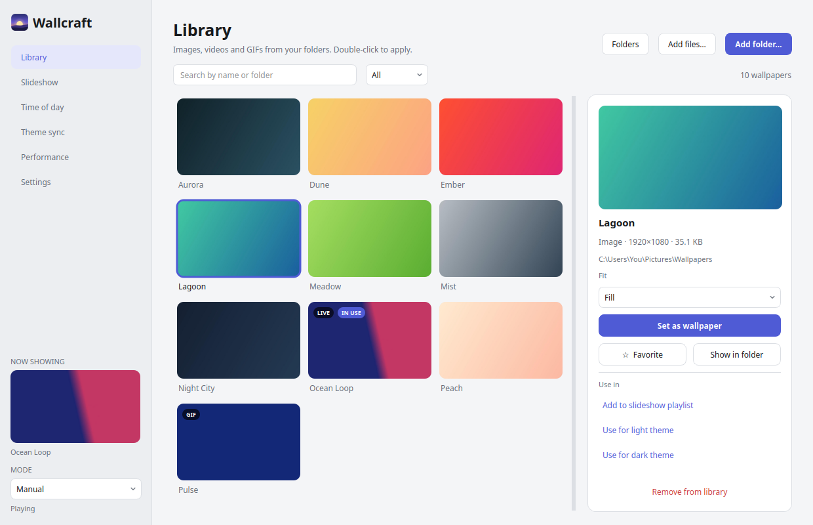

<p align="center">
  
</p>

<h1 align="center">Wallcraft</h1>

<p align="center">
  A free, open-source wallpaper manager for Windows: live video wallpapers, wallpapers that follow
  the time of day, and light/dark theme sync.
</p>

<p align="center">
  <a href="../../releases/latest"><strong>Download for Windows</strong></a> ·
  <a href="#features">Features</a> ·
  <a href="#building-from-source">Build from source</a> ·
  <a href="CONTRIBUTING.md">Contribute</a>
</p>



## Features

**Library**
- Add folders (scanned recursively and watched for new files) or individual files, or drag and drop them onto the window.
- Search, filter by images / live / favourites, and preview with resolution and file size.
- Set a different wallpaper on each monitor, with every Windows fit mode: fill, fit, stretch, center, tile and span.
- WebP and other formats Windows can't show natively are converted automatically.

**Live wallpapers**
- Videos and animated images play *behind your desktop icons*, on one or all monitors:
  - **Video:** MP4, M4V, MOV, MKV, WebM, AVI, WMV, ASF, MPG/MPEG, M2V, VOB, TS, M2TS, MTS, FLV, F4V, 3GP, 3G2, OGV
  - **Codecs:** H.264, H.265/HEVC, VP8, VP9, AV1\*, MPEG-1/2/4, WMV, Theora, Motion JPEG
  - **Animated images:** GIF and animated WebP (a still WebP is treated as a normal image)

  \*AV1 needs a graphics card with AV1 decoding (most from 2020 onward).
- Hardware video decoding through Qt Multimedia / FFmpeg.
- A still frame from the video is set as the regular Windows wallpaper underneath, so the desktop never goes blank when playback stops or Wallcraft quits.
- Muted by default. With several monitors, only one plays sound.

**Modes**
| Mode | What it does |
| --- | --- |
| Manual | You pick the wallpaper (per monitor if you like). |
| Slideshow | Rotates through your whole library or a custom playlist, in order or shuffled, every *N* minutes. |
| Time of day | Switches wallpaper at fixed times or at **dawn, sunrise, solar noon, sunset and dusk**, with offsets (for example "30 minutes before sunset"). Sun times are calculated offline from your location. |
| Follow Windows theme | Uses one wallpaper in light mode and another in dark mode, and swaps as soon as Windows changes. |

**Theme sync**
- Automatically switch Windows between light and dark mode at sunrise/sunset or at custom times, for apps, the taskbar, or both.
- Only switches at the scheduled moments, so you can still change the theme by hand in between.
- Wallcraft's own window follows the Windows theme too (or pick light/dark).

**Performance and battery rules**

Live wallpapers can pause (freeze the frame) or stop (unload the video and show its still image) when:
- the laptop is on battery, below a battery percentage you choose, or battery saver is on
- an app is fullscreen, such as a game, video or presentation (only on that monitor)
- a window is maximized (only on that monitor)
- the screen is locked

When several rules match, the strongest action wins. You can also pause from the tray at any time.

**Everyday comforts**
- Tray icon with next/previous, pause and mode switching
- Start with Windows (no admin rights needed)
- Single instance: launching Wallcraft again just brings the window forward
- Portable mode, and recovers by itself if Explorer restarts or monitors change

## Install

Download from the [latest release](../../releases/latest):

| File | Use it if… |
| --- | --- |
| `Wallcraft-x.y.z-Setup.exe` | You want a normal install with a Start menu entry. Installs per user, no admin rights. |
| `Wallcraft-x.y.z-portable.exe` | You want a single exe with nothing to install. |
| `Wallcraft-x.y.z-win64.zip` | You want the unpacked folder (starts fastest, good for portable use). |

**Requirements:** Windows 10 (1809 or later) or Windows 11, 64-bit.

> **"Windows protected your PC"?** Release builds aren't code-signed yet, so SmartScreen may warn on first launch.
> Click **More info → Run anyway**. You can check the download against `SHA256SUMS.txt` in the release,
> or [build it yourself](#building-from-source).

### Portable mode
Create a folder named `wallcraft-data` next to `Wallcraft.exe` and all settings, thumbnails and logs are stored there instead of in your user profile.

## Using Wallcraft

1. **Library → Add folder…** and pick a folder of wallpapers.
2. Double-click a wallpaper to apply it, or select it and use the panel on the right to choose the monitor and fit.
3. To automate things, open **Slideshow**, **Time of day** or **Theme sync**, set it up, and click **Turn on**. Only one mode is active at a time. The current mode is also shown at the bottom of the sidebar and in the tray menu.
4. Adjust **Performance** rules if you use live wallpapers on a laptop.

Closing the window keeps Wallcraft running in the tray. Choose **Quit Wallcraft** from the tray menu to exit.

### Where settings are stored

| What | Location |
| --- | --- |
| Settings | `%APPDATA%\Wallcraft\config.json` |
| Thumbnails, video still frames | `%LOCALAPPDATA%\Wallcraft\cache` |
| Logs | `%LOCALAPPDATA%\Wallcraft\logs\wallcraft.log` |

## Troubleshooting

- **The live wallpaper doesn't show, or vanished.** Wallcraft re-attaches automatically after Explorer restarts. If it still isn't visible, restart Wallcraft from the tray. Then open an issue with your Windows version (`winver`) and the log file attached.
- **The wallpaper looks blurry.** Turn on *Settings → Keep JPEG wallpapers at full quality* (Windows re-compresses JPEGs by default).
- **A video doesn't play.** Check the codec is in the list above. AV1 needs a graphics card that decodes it. The log file shows the decoder error.

## Building from source

You need Python 3.10+ (3.12 recommended) and Git.

```powershell
git clone https://github.com/YOUR_USERNAME/wallcraft.git
cd wallcraft
python -m venv .venv
.venv\Scripts\activate
pip install -r requirements-dev.txt

python -m wallcraft            # run from source
python -m pytest               # run the tests
```

Build the executables:

```powershell
powershell -ExecutionPolicy Bypass -File scripts\build.ps1
```

This creates `dist\Wallcraft.exe` (portable), `dist\Wallcraft\` (folder build) and, if [Inno Setup 6](https://jrsoftware.org/isdl.php) is installed, `dist\Wallcraft-x.y.z-Setup.exe`.

The app also runs on Linux and macOS for development. Live wallpapers then open in a preview window instead of on the desktop.

### Releasing

1. Update `__version__` in `src/wallcraft/__init__.py` and `CHANGELOG.md`.
2. Commit, then tag and push: `git tag v0.1.0 && git push origin v0.1.0`.
3. GitHub Actions tests, builds and publishes the release with the installer, portable exe, zip and checksums.

## How it works

```
src/wallcraft/
├── app.py               startup, logging, single instance, tray
├── controller.py        the engine: picks a wallpaper per monitor and keeps it applied
├── config.py            settings model and JSON persistence
├── schedule.py          time-of-day and theme scheduling
├── solar.py             offline sunrise/sunset calculation
├── slideshow.py         playlist ordering
├── rules.py             performance/battery rules
├── library.py           media types and folder scanning
├── live/                video and GIF players, one window per monitor
├── services/            library, thumbnails, video still frames, config store
├── platform/windows/    Win32 via ctypes: IDesktopWallpaper, WorkerW embedding, power, theme
└── ui/                  Qt (PySide6) interface
```

- **Static wallpapers** use the `IDesktopWallpaper` COM interface (per-monitor), falling back to `SystemParametersInfo`.
- **Live wallpapers** use the WorkerW technique: Wallcraft asks Explorer to create a window layer between the wallpaper and the icons, then places its video windows in that layer. Both the classic layout and the Windows 11 24H2 layout are handled.
- All Windows calls go through `ctypes`, so there are no compiled extensions or pywin32 dependency.

## Contributing

Bug reports, ideas and pull requests are welcome. See [CONTRIBUTING.md](CONTRIBUTING.md).

## License

[MIT](LICENSE)
